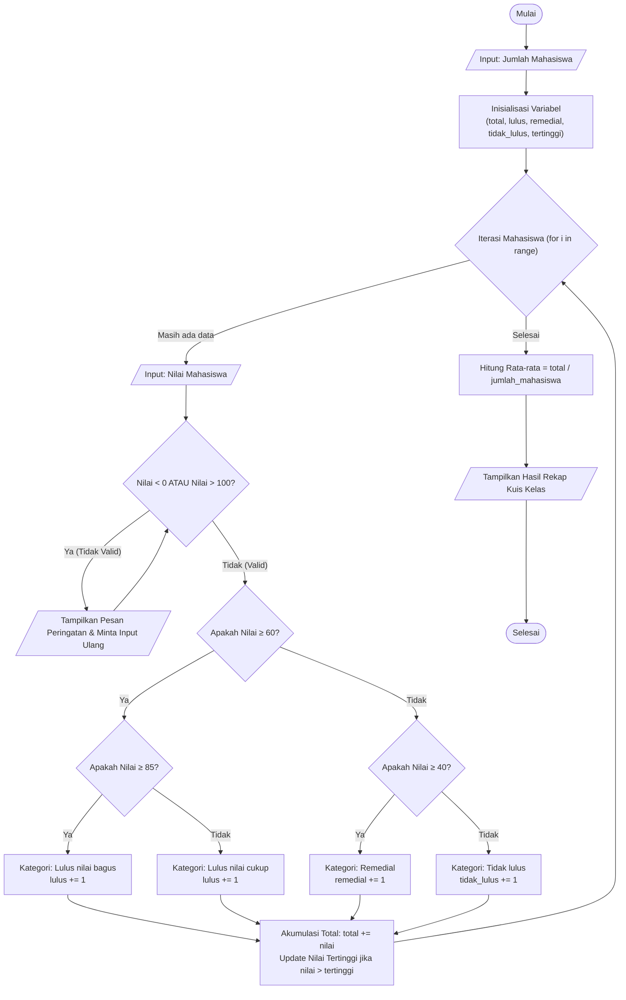

# Laporan Praktikum Modul 2: Perulangan, Validasi Input, dan Percabangan Bertingkat


---

## 📖 Deskripsi Studi Kasus
Pada praktikum Modul 2 ini, dibuat sebuah program Python bernama **Program Rekap Nilai Kuis Kelas**. Program ini dirancang untuk membantu dosen merekapitulasi data nilai kuis mahasiswa dalam satu kelas secara dinamis.

Program meminta input jumlah mahasiswa, menerima nilai setiap mahasiswa dengan mekanisme validasi ketat (hanya menerima rentang 0–100), mengelompokkan nilai ke dalam kategori kelulusan menggunakan **percabangan bertingkat (*nested if-else*)**, serta menghasilkan rekapitulasi statistik kelas di akhir eksekusi.

---

## 🎯 Aturan & Ketentuan Program

### 1. Ketentuan Input & Validasi Data
- **Jumlah Mahasiswa**: Menerima input integer positif.
- **Validasi Nilai**: Nilai harus berada dalam rentang **0 hingga 100**. Jika pengguna memasukkan nilai `< 0` atau `> 100`, program akan menampilkan peringatan dan meminta input ulang hingga nilai valid (*looping while*).

### 2. Kategori Kelulusan (Percabangan Bertingkat)
Setiap nilai mahasiswa diklasifikasikan ke dalam kategori berikut:

| Rentang Nilai | Kategori Kelulusan | Status Kelulusan | Counter Program |
| :---: | :--- | :---: | :---: |
| **85 – 100** | Lulus dengan nilai bagus (*Lulus Sangat Baik*) | Lulus | `lulus += 1` |
| **60 – 84** | Lulus dengan nilai cukup (*Lulus*) | Lulus | `lulus += 1` |
| **40 – 59** | Remedial | Remedial | `remedial += 1` |
| **< 40** | Tidak Lulus | Tidak Lulus | `tidak_lulus += 1` |

### 3. Rekapitulasi Akhir Kelas
Setelah seluruh data mahasiswa dimasukkan, program menampilkan rekap:
- **Rata-rata Nilai Kelas** (`total / jumlah_mahasiswa`)
- **Nilai Tertinggi**
- **Jumlah Mahasiswa Lulus**
- **Jumlah Mahasiswa Remedial**
- **Jumlah Mahasiswa Tidak Lulus**

---

## 🔄 Alur Program (Flowchart)



---

## 💻 Implementasi Kode (`studi_kasus.py`)

Berikut adalah kode program pada file [`studi_kasus.py`](studi_kasus.py):

```python
total = 0
lulus = 0
remedial = 0
tidak_lulus = 0
tertinggi = 0

print("=== Program Rekap Nilai Kuis Kelas ===")
jumlah_mahasiswa = int(input("Masukkan jumlah mahasiswa: "))

for i in range(jumlah_mahasiswa):
    print(f"\nMasukkan nilai mahasiswa ke-{i+1}:")
    nilai = int(input("Masukkan nilai: "))

    # Perbaikan operator: > 100 (bukan < 100)
    while nilai < 0 or nilai > 100:
        print("Nilai tidak valid, masukkan nilai antara 0-100")
        nilai = int(input("Masukkan nilai kembali: "))

    # Percabangan bertingkat
    if nilai >= 60:
        if nilai >= 85:
            kategori = "Lulus dengan nilai bagus"
        else:
            kategori = "Lulus dengan nilai cukup" 
        lulus += 1
    else:
        if nilai >= 40:
            kategori = "Remedial"
            remedial += 1 
        else:
            kategori = "Tidak lulus"
            tidak_lulus += 1

    print("Kategori :", kategori)

    # Akumulasi total dan pengecekan nilai tertinggi
    total += nilai
    if nilai > tertinggi:
        tertinggi = nilai

# Perhitungan rata-rata dilakukan setelah perulangan 'for' selesai
if jumlah_mahasiswa > 0:
    rata_rata = total / jumlah_mahasiswa
else:
    rata_rata = 0

print("==== REKAP KUIS ====")
print("Rata-rata  :", rata_rata)
print("Tertinggi  :", tertinggi)
print("Lulus      :", lulus)
print("Remedial   :", remedial)
print("Tidak Lulus:", tidak_lulus)
```

### 🔍 Penjelasan Komponen Kode:
1. **Inisialisasi Variabel Akumulator**:
   - `total`, `lulus`, `remedial`, `tidak_lulus`, dan `tertinggi` disiapkan di awal dengan nilai `0` untuk menampung agregasi data selama perulangan.
2. **Perulangan `for`**:
   - `for i in range(jumlah_mahasiswa)` digunakan untuk menjalankan iterasi input data sebanyak jumlah mahasiswa yang dimasukkan.
3. **Validasi Input dengan `while`**:
   - Memeriksa kondisi `while nilai < 0 or nilai > 100`. Program tidak akan melanjutkan ke tahap berikutnya sebelum pengguna memasukkan angka yang berada dalam rentang 0 hingga 100.
4. **Percabangan Bertingkat (*Nested if-else*)**:
   - Tingkat pertama memisahkan antara nilai kelulusan (&ge; 60) dan nilai belum lulus (< 60).
   - Tingkat kedua membagi lagi masing-masing kategori menjadi:
     - &ge; 85: Nilai bagus (*Lulus*)
     - < 85: Nilai cukup (*Lulus*)
     - &ge; 40: *Remedial*
     - < 40: *Tidak Lulus*
5. **Pencarian Nilai Tertinggi & Akumulasi**:
   - `if nilai > tertinggi: tertinggi = nilai` memperbarui rekor nilai tertinggi yang ditemukan.
   - `total += nilai` menjumlahkan seluruh nilai untuk perhitungan rata-rata.
6. **Perhitungan Rata-rata**:
   - Dilakukan pengecekan `if jumlah_mahasiswa > 0` sebelum pembagian guna menghindari galat *ZeroDivisionError*.

---

## 🧪 Hasil Uji Coba (Testing)

### Kasus 1: Pengujian Normal (Semua Kategori Nilai Terpenuhi)
- **Input Data:**
  - Jumlah mahasiswa: `4`
  - Mahasiswa 1: `90` (Kategori: Lulus nilai bagus)
  - Mahasiswa 2: `70` (Kategori: Lulus nilai cukup)
  - Mahasiswa 3: `50` (Kategori: Remedial)
  - Mahasiswa 4: `30` (Kategori: Tidak lulus)
- **Output Terminal:**
  ```text
  === Program Rekap Nilai Kuis Kelas ===
  Masukkan jumlah mahasiswa: 4

  Masukkan nilai mahasiswa ke-1:
  Masukkan nilai: 90
  Kategori : Lulus dengan nilai bagus

  Masukkan nilai mahasiswa ke-2:
  Masukkan nilai: 70
  Kategori : Lulus dengan nilai cukup

  Masukkan nilai mahasiswa ke-3:
  Masukkan nilai: 50
  Kategori : Remedial

  Masukkan nilai mahasiswa ke-4:
  Masukkan nilai: 30
  Kategori : Tidak lulus

  ==== REKAP KUIS ====
  Rata-rata  : 60.0
  Tertinggi  : 90
  Lulus      : 2
  Remedial   : 1
  Tidak Lulus: 1
  ```

---

### Kasus 2: Pengujian Validasi Nilai di Luar Rentang
- **Input Data:**
  - Jumlah mahasiswa: `1`
  - Input pertama: `120` (Tidak valid `> 100`)
  - Input kedua: `-10` (Tidak valid `< 0`)
  - Input ketiga: `88` (Valid)
- **Output Terminal:**
  ```text
  === Program Rekap Nilai Kuis Kelas ===
  Masukkan jumlah mahasiswa: 1

  Masukkan nilai mahasiswa ke-1:
  Masukkan nilai: 120
  Nilai tidak valid, masukkan nilai antara 0-100
  Masukkan nilai kembali: -10
  Nilai tidak valid, masukkan nilai antara 0-100
  Masukkan nilai kembali: 88
  Kategori : Lulus dengan nilai bagus

  ==== REKAP KUIS ====
  Rata-rata  : 88.0
  Tertinggi  : 88
  Lulus      : 1
  Remedial   : 0
  Tidak Lulus: 0
  ```

---

## 🚀 Cara Menjalankan Program

1. Buka terminal dan arahkan ke direktori modul 2:
   ```bash
   cd modul2
   ```

2. Jalankan file program:
   ```bash
   python3 studi_kasus.py
   ```

3. Masukkan jumlah mahasiswa dan input nilai tiap mahasiswa sesuai instruksi.

---

## 📌 Kesimpulan
Berdasarkan praktikum Modul 2 ini:
- Perulangan `for` terbukti efektif untuk menangani proses input data berulang dengan batas yang sudah diketahui (`jumlah_mahasiswa`).
- Validasi menggunakan perulangan `while` berhasil memastikan integritas data agar nilai yang diproses selalu berada pada rentang valid (0–100).
- Struktur percabangan bertingkat (*nested if-else*) memungkinkan pengelompokan kategori yang lebih spesifik dan terstruktur.
- Variabel akumulator dan pembanding berhasil menghitung nilai total, rata-rata, nilai tertinggi, serta frekuensi mahasiswa pada tiap status kelulusan.
